# HomeStocker · 家里小仓库

> 家庭协同物资台账微信小程序 —— 家人建家、记账、分空间放货、看临期、看家庭消息，并用自然语言跟「家庭管家」改库存。

[](https://github.com/cmes1024/HomeStocker)
[](https://developers.weixin.qq.com/miniprogram/dev/framework/)
[](https://openjdk.org/)
[](https://spring.io/projects/spring-boot)
[](https://www.postgresql.org/)
[](https://redis.io/)
[](https://docs.docker.com/compose/)
[](https://langchain-ai.github.io/langgraph/)
[](LICENSE)

<p align="center">
  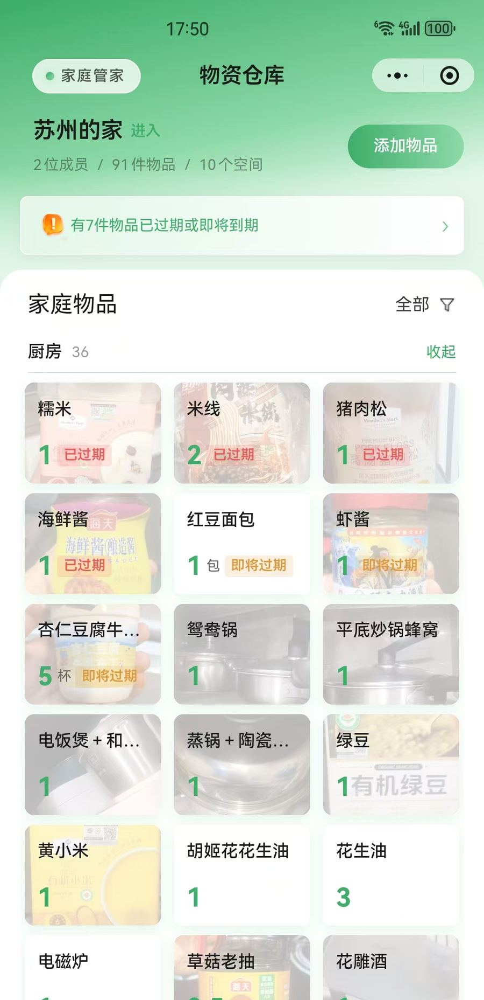
  &nbsp;&nbsp;
  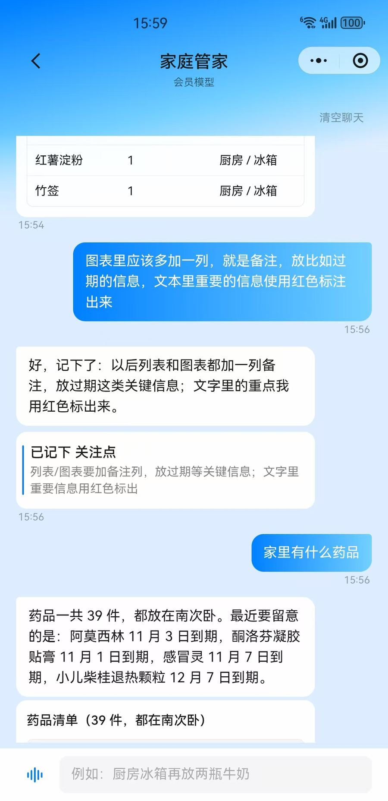
</p>

<p align="center"><sub>左：首页台账（按空间分组 + 临期提醒）&#12288;右：家庭管家（记关注点、查药品清单）</sub></p>

<details>
<summary>更多界面：语音记账、物资详情、家庭消息、过期提醒推送、空间与位置、家庭页、主题、按图预填、AI 配置</summary>

<p align="center">
  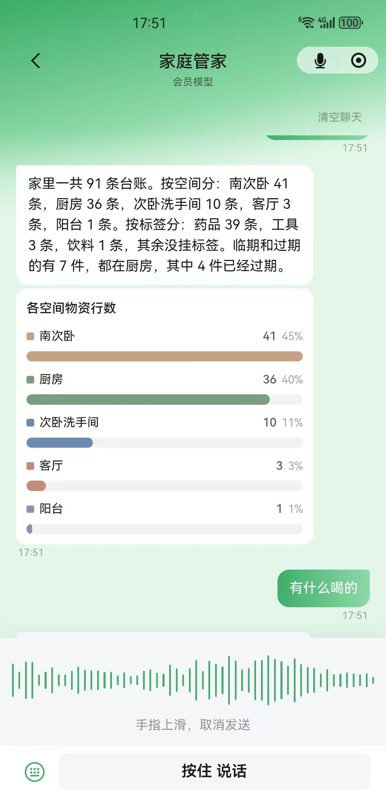
  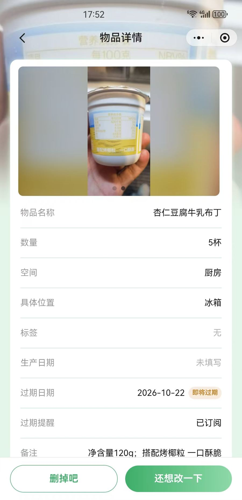
  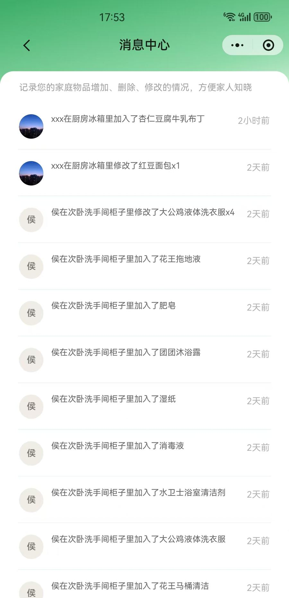
  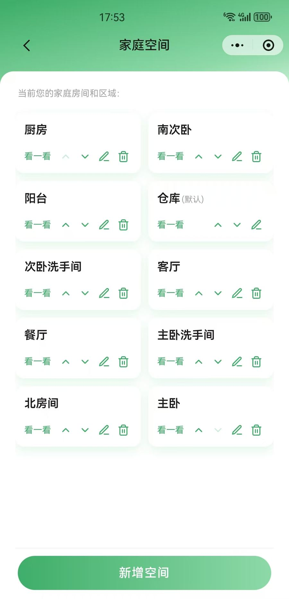
</p>

<p align="center"><sub>语音输入（按住说话）&#12288; 物资详情（日期 / 过期订阅）&#12288; 消息中心（家庭操作流）&#12288; 空间列表（含默认「仓库」）</sub></p>

<p align="center">
  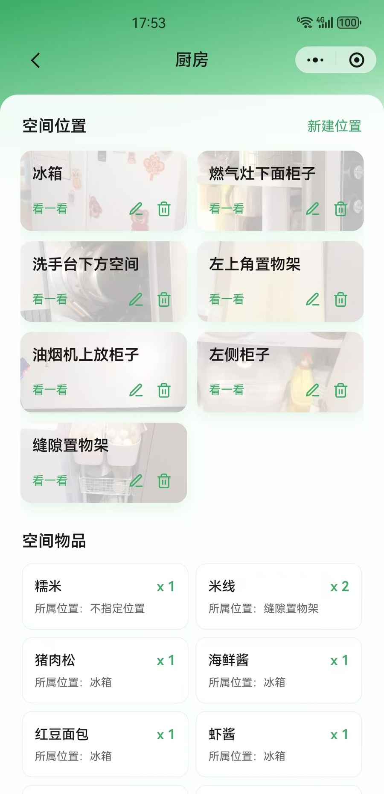
  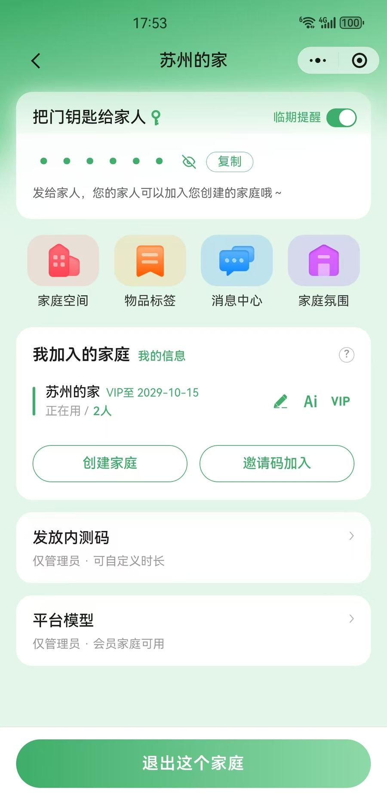
  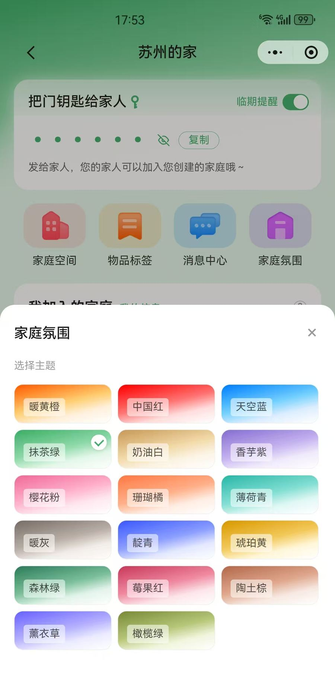
</p>

<p align="center"><sub>空间详情（位置 + 物品）&#12288; 家庭页（邀请码 / 容量档）&#12288; 家庭氛围主题</sub></p>

<p align="center">
  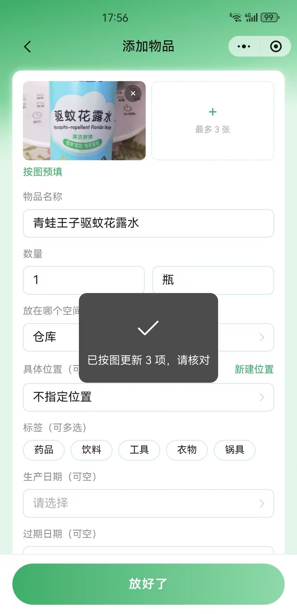
  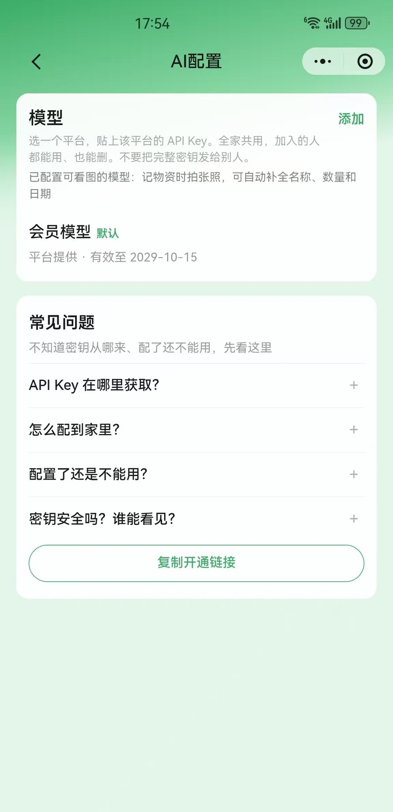
  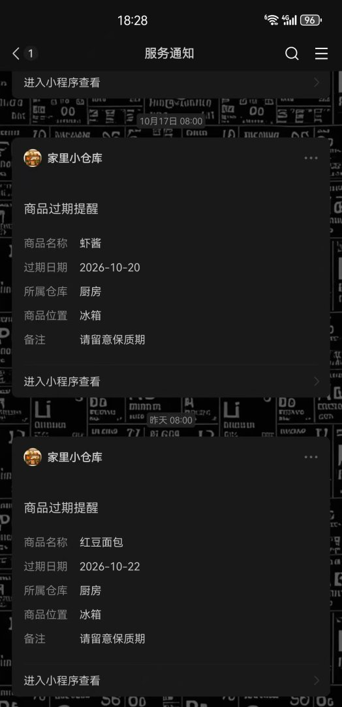
</p>

<p align="center"><sub>按图预填（识别后人工核对）&#12288; AI 配置（BYOK + 可看图模型）&#12288; 过期提醒推送（仓库 / 位置 / 备注）</sub></p>

</details>

> **当前版本 v2（Java 后端）**：已完成 **云开发 → 自建 Spring Boot** 迁移 —— 业务读写、鉴权、定时提醒、AI 管家、对象存储全部走 `server/`，不再依赖云函数 / 云开发客户端。
> v1 云开发版已冻结为 tag `v1.0-cloudbase`，代码未删除、可随时检出，见下方「版本里程碑」。

---

## ✨ 核心能力

- **家庭协同**：创建家庭 / 邀请码加入 / 多家庭切换（`memberships` + `currentFamilyId`），全员同权；免费档 1 家 · 2 人 · 50 件 · 消息 30 条，兑换码升加强版后家/人/物不限
- **物资台账**：名称 / 数量 / 单位 / 备注 + 空间必填、位置可选 + 多标签 + 生产/过期日期 + 最多 3 张图（首图为封面）
- **空间体系**：用户自建空间与位置，无空间时懒创建默认「仓库」；清单按空间分组，也可按空间筛选
- **保质期管理**：首页「即将过期」聚合；`itemExpireSubs` **按人 × 物资**订阅消息（3 / 1 / 0 天），家庭侧另有总开关
- **家庭消息流**：物资增删改自动写 `activities`，带空间 / 位置快照与变更字段，详情页展示最近操作
- **命名主题**：家庭维度自定义主色 / 副色 / 阴影色，全站由 AppShell 注入 CSS 变量
- **🤖 家庭管家（AI）**：一句话查库存、记一件、增减数（"哪些快过期了""厨房冰箱再放两瓶牛奶"）；**语音输入**（微信同声传译，按住说话 / 上滑取消，识别成字后与打字同路提交）；支持 **BYOK**（家庭自带 DeepSeek 等 Key，也走托管池）；写操作与手动操作共用同一入口，落库标记 `source: agent`，可审计
- **📷 按图预填**：编辑页拍照 / 选图后调 `ai.capture` 做一次性视觉抽取（名称 / 数量 / 单位 / 备注 / 生产日期 / 过期日期），**只读、不写账**；回填后由人核对，保存仍走 `item.create` / `item.update`；用户手改过的字段不会被覆盖

## 🏗️ 技术架构

```
┌───────────────────────────────────────────────────────┐
│ 微信原生小程序                                          │
│ 主包：onboarding / 物资台账 / 家庭                       │
│ 分包：packageBrowse（空间/详情/口袋）                     │
│       packageAi（家庭密钥 BYOK）· packageAiAssist（管家） │
└──────────────────────┬────────────────────────────────┘
                       │ utils/cloud.js（读缓存门面）
                       │   → utils/javaApi.js
                       │ POST /api/{module}/{action}
                       │ X-HS-Token
┌──────────────────────┴────────────────────────────────┐
│ Spring Boot 3.3 · Java 17                              │
│ auth(code2session + Redis Session)                     │
│ family / item / space / tag / activity                 │
│ bootstrap · storage(MinIO) · notify(定时临期)             │
│ ai.act（文本/工具循环）· ai.capture（视觉抽取）             │
└──────────────────────┬────────────────────────────────┘
                       │
      PostgreSQL 16 + Flyway · Redis 7 · MinIO · Docker Compose

      ┌ 实验支线（未接产品链路）─────────────────────────┐
      │ agent/  LangGraph + FastAPI + MockBackend        │
      │ load_context → classify → call_tool → respond    │
      └─────────────────────────────────────────────────┘
```

| 层 | 选型 |
|----|------|
| 前端 | 微信原生小程序（主包 + 3 个功能分包）；语音输入用微信同声传译 `WechatSI` 插件 |
| 后端 | Java 17 + Spring Boot 3.3，模块以 `POST /api/{module}/{action}` 暴露 |
| 数据库 | PostgreSQL 16 + Flyway 版本化迁移 |
| 缓存 / 会话 | Redis 7（Session、`X-HS-Token`、活动游标、家庭树） |
| 对象存储 | 本地 MinIO；上线可换 COS / OSS |
| AI | `ai.act`（文本工具循环）+ `ai.capture`（视觉抽取）；OpenAI 兼容端点，家庭 BYOK 优先、hosted 池兜底 |
| 部署 | Docker Compose（本地与单机服务器同一套，无需本机 JDK / Maven） |

## 🎯 工程设计与取舍

- **身份不可伪造**：openid 只由服务端 `code2session` 换取，客户端传参一律不采信；每次请求按 openid 解析 `currentFamilyId` + membership，再用 `FamilyContext` 做家庭维度隔离
- **单一写模型**：页面、AI 管家、未来的对话 Agent 共用 `item` / `space` / `tag` 写路径，活动流由写路径旁路产生，不另开一套改库逻辑
- **AI 只做编排，不做关键词路由**：严格禁止正则 / 固定话术表把用户句子映射成固定接口调用；该增该减、要不要确认，全由模型基于 history 与查库结果（`PROBE` / 候选集 / `quantityBefore`）决定，客户端只做短号解析、白名单校验与确认闸门
- **语音只是输入通道**：按住说话 → 同声传译转文字 → 与键盘输入走同一条 `ai.act` 调用，客户端不解析语音意图；权限按「隐私授权 → `scope.record`」两级申请，拒绝后引导去设置，按住时长过短 / 无识别结果 / 插件不可用各有独立提示，上滑越阈值即取消
- **视觉只做预填，不碰写路径**：`ai.capture` 只返回字段、不入库、不产活动、不进 history；入口可见性由 `ai.listKeys` 的 `visionAvailable` 决定（无视觉密钥则隐藏），识别用独立 `capturing` 状态，失败只 toast 不挡保存；多图时「上传哪张识别哪张」，当前表单快照随图发送，由模型对比后定夺每个字段
- **读缓存门面**：`utils/cloud.js` 统一收口读请求与本地缓存失效，页面不直连网络层，切后端只改一处
- **迁移可控**：Flyway 管理表结构，M0–M9 按模块逐步切流，小程序配置集中在 `miniprogram/config/index.js`

## 🤖 AI 参与度（开发方式说明）

这个项目不只是「产品里有 AI」，开发过程本身也按规格驱动的 AI 工作流交付：

- **OpenSpec 规格驱动**：[`openspec/`](openspec/) 每个能力变更走 proposal → design → tasks → specs，`openspec/` 内 160+ 篇规格文档形成可追溯的行为契约
- **管家能力可回归**：[`ai-eval/`](ai-eval/) 500+ 条口语化评测用例（日常使用 / 边界陷阱 / 课程进阶 / 红线），分 plan 用 `ai.act` 实跑判定——**AI 能力像代码一样被测试**
- **多 IDE 适配**：`.claude` / `.cursor` / `.kiro` / `.trae` / `.qoder` / `.hermes` / `.agents` 七套 skills 与命令，同一套规格在不同工具间复用
- **Agent 工程化**：[`agent/`](agent/README.md) LangGraph 状态图 + 4 个工具 + `MockBackend`，可免真实 Key 跑冒烟测试
- **协作护栏**：[`AGENTS.md`](AGENTS.md) 固化工作约定（改动范围、先方案后动手、未要求不擅自 commit）
- **分工**：人工负责产品定义、家庭场景建模、Agent 安全设计（`family_id` 强制注入）、架构迁移决策；AI 负责规格同步、模块化实现、评测用例与按流程执行变更

> 一句话：**把「AI 功能」当软件工程做** —— 规格可追溯、能力可回归、调用可约束。

## 🚀 快速开始

前提：**Docker Desktop**（或兼容引擎）+ 微信开发者工具。不必本机安装 JDK / Maven。

```bash
git clone https://github.com/cmes1024/HomeStocker.git
cd HomeStocker    # main 即 v2（Java 后端）主线
```

### 1. 启动后端

```bash
cd server
cp .env.example .env      # 填入 WECHAT_APP_ID / WECHAT_APP_SECRET（与小程序 AppId 一致）
docker compose up --build
curl http://localhost:8080/api/health
```

| 服务 | 端口 |
|------|------|
| api | 8080 |
| postgres | 5432 |
| redis | 6379 |
| minio | 9000（API）/ 9001（控制台） |

首次构建要拉 Maven 依赖，会慢一些；改 Java 后重建：`docker compose up --build -d api`。

### 2. 连接小程序

1. 开发者工具打开 `miniprogram/`，详情 → 本地设置 → **不校验合法域名**
2. `miniprogram/config/index.js`：`javaBaseUrl` 默认 `http://127.0.0.1:8080`，真机改成电脑局域网 IP
3. `authUseMockCode` 保持 `false`（真实 `wx.login` → 服务端 `code2session`）

更细的联调说明见 [`06-local-dev.md`](docs/plans/2026-09-30-java-backend-migration/06-local-dev.md)。

### 3. 可选：LangGraph Agent 实验服务

```bash
cd agent
uv sync && cp .env.example .env          # 填 LLM_API_KEY（OpenAI 兼容端点）
uv run python smoke_test.py              # 免真实 Key 冒烟
uv run uvicorn server:app --reload --port 8000
```

## 📂 项目结构

```text
HomeStocker/
├── miniprogram/                 # 微信原生小程序（唯一产品前端）
│   ├── config/index.js          # API 地址、AppId、登录 mock 开关
│   ├── pages/                   # 主包：onboarding / items / family
│   ├── packageBrowse/           # 空间、物资详情、口袋
│   ├── packageAi/               # 家庭密钥页（BYOK）
│   └── packageAiAssist/         # 家庭管家
├── server/                      # Spring Boot 权威后端（Docker Compose 一键起）
│   ├── docker-compose.yml
│   └── src/                     # Java + Flyway 迁移脚本
├── agent/                       # LangGraph 对话雏形（实验支线）
├── ai-eval/                     # 管家能力评测题库与 runner
├── openspec/                    # 行为规格与变更管理
├── docs/plans/                  # 设计与实施文档（含 Java 迁移系列）
├── family-supplies-prototype*/  # 产品原型（HTML，非运行时）
└── AGENTS.md                    # 给 Agent / 协作者的工作约定
```

## 🔌 API 模块一览

与历史云函数 action 名对齐：`auth` / `family` / `item` / `space` / `tag` / `activity` / `bootstrap` / `ai` / `storage` / `notify`。

- 物资写一律走 `item`，成功后旁路写 `activities`
- AI 管家经白名单 tool 调同一写路径（`source: agent`）
- 请求头 `X-HS-Token`（login 后下发）；服务端 openid → `currentFamilyId` + membership
- 服务端细节见 [`server/README.md`](server/README.md)

## 🖥️ 服务器部署（单机 Docker）

与本地同一套 Compose：机器上只需 Docker。公网域名、HTTPS、微信合法域名属上线运维（M10），勾选清单见 [`07-cutover-checklist.md`](docs/plans/2026-09-30-java-backend-migration/07-cutover-checklist.md)。

```bash
git clone https://github.com/cmes1024/HomeStocker.git && cd HomeStocker/server
cp .env.example .env      # 勿提交 git
docker compose up --build -d
curl http://127.0.0.1:8080/api/health   # 期望包含 "ok": true
```

| 变量 | 说明 |
|------|------|
| `WECHAT_APP_ID` / `WECHAT_APP_SECRET` | 与小程序 AppId 一致；`WECHAT_MOCK_ENABLED=false` |
| `MINIO_PUBLIC_ENDPOINT` | 小程序可达的图片基址（同域反代或图床子域，不占 request 合法域名） |
| `ADMIN_OPENIDS` | 可选；可发内测码的 openid，逗号分隔 |
| `CAPACITY_ADMIN_WECHAT` | 可选；管家话术里引导添加的微信号 |
| `EXPIRE_SUBSCRIBE_TMPL_ID` | 临期订阅消息模板 ID |

- **HTTPS**：Nginx / Caddy 把 `https://api.你的域名` 反代到本机 `8080`；微信后台「request 合法域名」填该主机
- **备份**：Postgres 数据卷 `hs_pg_data` 需定期备份
- **停服**：`docker compose down` 保留卷；`down -v` 会清空数据，慎用
- **安全**：生产务必改掉 Compose 默认的 Postgres / MinIO 口令，5432 / 6379 / 9000 / 9001 不要对公网裸露

## 🧭 版本里程碑

项目按技术栈分成两个都跑得起来的版本，旧版不删除，以 tag 冻结：

| 版本 | 位置 | 技术栈 | 状态 |
|------|------|--------|------|
| **v2 Java 版** | `main` 分支 | 微信原生小程序 + Java 17 / Spring Boot 3.3 / PostgreSQL / Redis / MinIO | 当前主线 |
| **v1 云开发版** | tag `v1.0-cloudbase` | 微信原生小程序 + 云函数 + 云数据库 | 冻结存档 |

```bash
git fetch --tags
git checkout v1.0-cloudbase    # 回到 v1 云开发版
git checkout main              # 回到 v2 主线
```

> v1 是项目第一个可用版本，`miniprogram/cloudfunctions/` 与 `utils/cloud.js`（`wx.cloud.callFunction`）完整保留；v1 → v2 的过程见[服务器迁移手册](服务器迁移手册.md)与 [Java 迁移路线图](docs/plans/2026-09-30-java-backend-migration/05-migration-roadmap.md)。

## 📌 迁移与路线状态

| 阶段 | 状态 |
|------|------|
| M0–M9 脚手架、鉴权、family / item / space / tag / activity、存储、过期通知、AI、小程序切流 | 代码已齐 |
| Docker 联调验收 | 随本机环境 |
| M10 关云控制台 / 存量数据迁移 / 公网上线 | 运维待办 |

已知待做：用户体系验收、首页搜索（搜索栏目前多为装饰）、按图预填的 openspec 归档（功能本身服务端已回归）。本阶段不做：角色权限、软删除物资本体、评论 / @ / 聊天、ES 搜索、实景 3D、半屏 LangGraph 对话入口。

## 📖 文档索引

| 想了解 | 去哪读 |
|--------|--------|
| 协作者 / Agent 约定 | [`AGENTS.md`](AGENTS.md) |
| 文档地图 | [`docs/README.md`](docs/README.md) |
| 第一阶段产品现状 | [`docs/plans/2026-09-17-phase1-status.md`](docs/plans/2026-09-17-phase1-status.md) |
| Java 迁移路线图 | [`05-migration-roadmap.md`](docs/plans/2026-09-30-java-backend-migration/05-migration-roadmap.md) |
| AI 管家设计（V3 基线） | [`docs/plans/2026-09-22-ai-assistant-v3/`](docs/plans/2026-09-22-ai-assistant-v3/) |
| 按图预填（`ai.capture`） | [`openspec/changes/ai-photo-prefill/`](openspec/changes/ai-photo-prefill/) |
| 管家排障手册 | [`迭代指南.md`](docs/plans/2026-09-23-ai-assist-curriculum/迭代指南.md) |
| 行为规格 | [`openspec/specs/`](openspec/specs/) |
| 管家评测题库 | [`ai-eval/README.md`](ai-eval/README.md) |
| 云开发 → Java 迁移记录 | [`服务器迁移手册.md`](服务器迁移手册.md) |

## 许可证

见 [LICENSE](LICENSE)。
