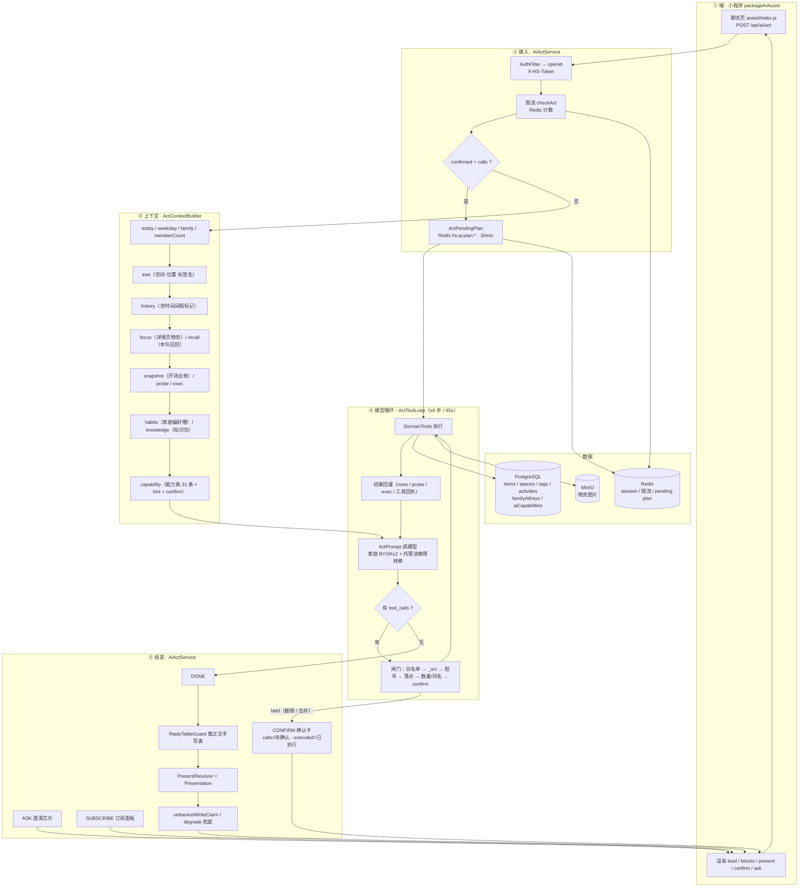
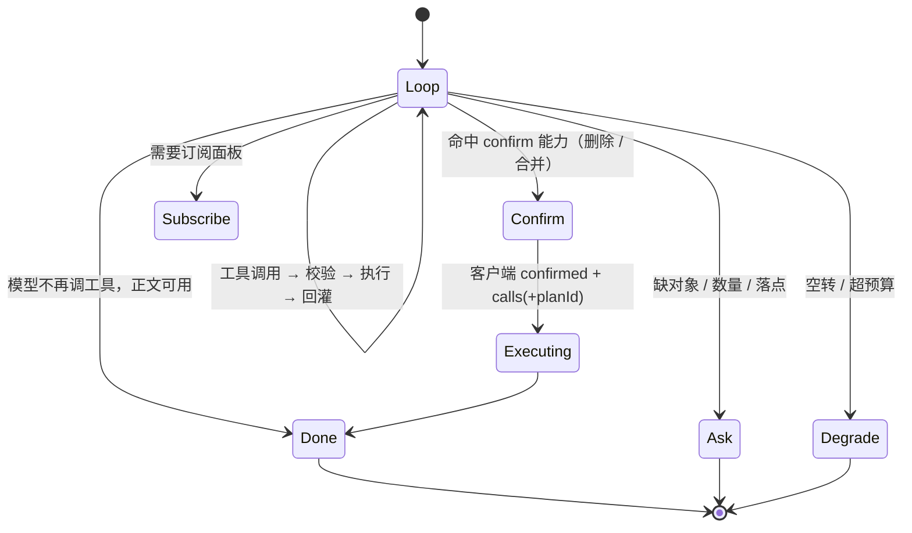
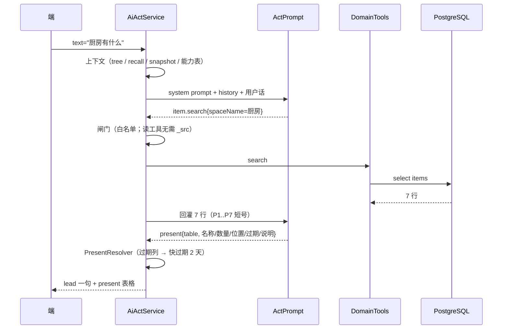
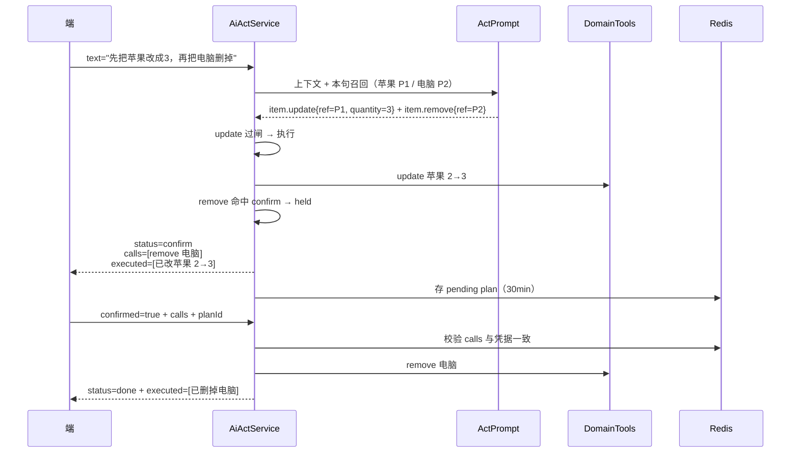

# 家庭管家内部架构与流程

> 依据代码实绘，不是设计稿。对照分支 `feature/ai-decision-authority`（含 2026-10-25 工作区未提交改动）。
> 代码若有变化，以「代码索引」里的文件为准，本文末尾标注了容易漂移的参数。

## 1. 分层架构

## 2. 一次请求的状态机

## 3. 两条典型链路

### 3.1 「厨房有什么」— 查 + 画表

### 3.2 「先把苹果改成3，再把电脑删掉」— 一段执行 + 一段确认

## 4. 五道闸门（顺序即代码顺序）

| # | 闸门 | 拦什么 | 失败回执 |
|---|---|---|---|
| 1 | 能力表白名单 | 未启用的工具 | 模型看不到该工具 |
| 2 | `Provenance`（`_src` 申报） | 落点/数量来源不可核：`user` 的 `quote` 必须出现在原话；`probe`/`inference` 必须带有效短号；`habit` 必须匹配习惯槽 | `PLACE_UNGROUNDED` / `QTY_UNGROUNDED` / `INFERENCE_NO_BASIS` / `REF_UNKNOWN` |
| 3 | `refUnknown` | F*/P* 短号本轮失效 | `REF_UNKNOWN` |
| 4 | `PlaceGrounding` | 落点不在家庭空间/位置树里 | `PLACE_UNGROUNDED` |
| 5 | `WriteGrounding` | 同名多条没指明；整条删除与库存数量对不上（数量按被删对象所在分句归属） | `REF_AMBIGUOUS` / `QTY_UNGROUNDED` |
| 6 | 能力表 `confirm` | 删除 / 合并 / 空间删除等 9 个写操作 | `WRITE_HELD` → 确认卡 |
| 7 | 执行 | 写库 + 旁路写 `activities`（`source=agent`） | 工具错误进 `report.failed` |

闸门不判断模型推理对不对，只核对机器事实（原话是否出现、短号是否存在、落点是否在树里、值与库存是否一致）。意图、改哪条、加还是减，全部由模型决定。

## 5. 关键参数

| 项 | 值 | 位置 |
|---|---|---|
| 工具步数上限 | 6（HEAD 是 4，工作区改动为 6） | `ToolSchemas.MAX_STEPS` |
| 单次 act 总预算 | 45 秒；单次调用上限 12 秒；剩余 < 1.5 秒不再开新轮 | `ActBudget` |
| 能力表 | 31 条，9 条需确认（`item.remove*`、`space.remove*`、`tag.remove*`、`item.merge`） | `capability-seed-v48.json` |
| 确认凭据 | Redis `hs:ai:plan:*`，30 分钟 | `ActPendingPlan` |
| 限流 | 30 次/分钟（容器环境变量 `AI_ACT_RATE_PER_MINUTE`） | `AiRateLimitService` |
| 模型钥匙 | 家庭 BYOK 最多试 2 把 + 平台托管池故障转移 | `ActPrompt` |

## 6. 代码索引

| 文件 | 职责 |
|---|---|
| `modules/ai/app/AiActService.java` | 入口、限流、confirm 重放、payload 组装（done/ask/confirm/subscribe） |
| `modules/ai/agent/ActContextBuilder.java` | 上下文：tree / history / focus / recall / snapshot / probe / exec / habits / knowledge / catalog |
| `modules/ai/agent/ActPrompt.java` | 模型 HTTP、钥匙池与故障转移、预算、prompt 渲染 |
| `modules/ai/agent/ActToolLoop.java` | 工具循环、五道闸门、短号、present 处理、预算/空转兜底 |
| `modules/ai/agent/Provenance.java` | `_src` 申报核验（user/probe/inference/habit） |
| `modules/ai/agent/PlaceGrounding.java` | 落点是否在家庭结构里 |
| `modules/ai/agent/WriteGrounding.java` | 同名多条、删除数量与库存核对 |
| `modules/ai/agent/ActRefs.java`、`ItemsProbe.java` | 短号签发、名称召回、按 id 装行 |
| `modules/ai/tools/DomainTools.java` | 工具执行 → 各 service |
| `modules/ai/agent/Presentation.java`、`PresentResolver.java`、`HabitReply.java` | 展示（blocks / 表格 / 统计 / 习惯） |
| `modules/ai/agent/ReplyTableGuard.java` | 裁掉正文里手写的表格 |
| `modules/ai/app/ActPendingPlan.java` | 确认凭据（Redis） |
| `modules/ai/app/AssistPromptTexts.java`、`resources/ai/capability-seed-v48.json` | 提示词与能力表 |
| `miniprogram/packageAiAssist/assist/index.js` | 请求、确认回传、渲染 |

## 7. 容易误解的点

- 模型不是"直接改库"：所有写都必须以工具调用形式发出，过闸门后由 `DomainTools` 落到与页面同一套 service。
- 读也不等于随便说：`item.search` 回灌的行会带 P* 短号，后续写只能引用本轮短号，不能自己编 `itemId`。
- 确认卡不是"整批原子"：同批里不触发 confirm 的写（如 `item.update`）已经落库，确认卡只覆盖 `calls` 里待确认的那几条；`executed` 字段用于回执已发生的事。
- 页面、管家、未来对话共用同一写入口；活动日志由写路径旁路产生，不由模型写。
- 禁止用关键词把话术映射到接口：闸门只做事实核验，路由由模型依上下文决定。
